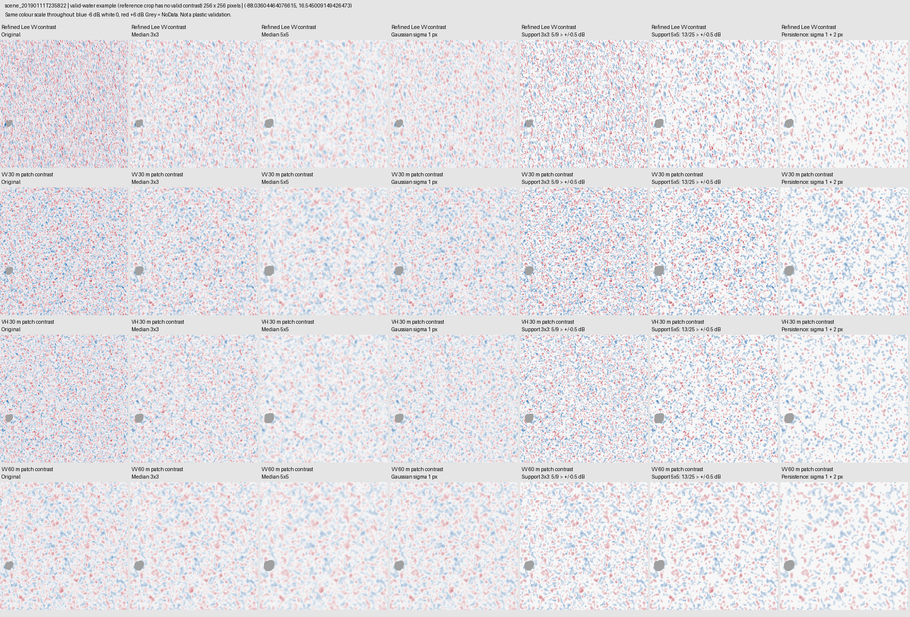
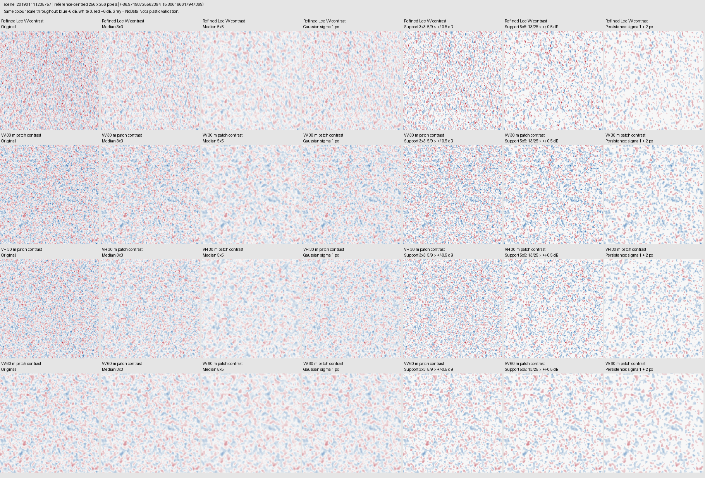

# Experimental contrast denoising — MARIDA 16PEC, 11 January 2019

Completed for the two scenes in this batch only. Six variants of each of four inputs: 24 layers per scene, 48 unique layers. Original inputs and their four QGIS layers remain unchanged. The batch project and both scene projects have backups and verified new groups.

In QGIS: each image → SAR rasters → Experimental contrast denoising | 2026-10-26 → input layer. Turn on one variant at a time. New layers start unchecked. Reopen the saved project to see the changes; an already-open QGIS session will not refresh automatically.

## Exact calculations

All operations act on existing signed contrast values in dB, not on raw linear SAR intensity. The native grid and extent remain unchanged. At this location pixels are about 13.4–13.9 m: 3×3 spans about 40–42 m and 5×5 about 67–70 m. These are additional filter footprints on inputs that already have their own spatial support.

**domain**: Already-computed signed contrast in dB; post-contrast display experiment, not a SAR noise calibration.

**median**: Median of 3x3 or 5x5 window; output only where entire window is valid.

**gaussian**: Normalized masked Gaussian sigma=1 pixel, truncate=3; requires >=90% valid kernel weight and valid center.

**support**: Retain original contrast only when center exceeds +0.5 dB and >=5/9 (or 13/25) cells exceed +0.5 dB, or symmetric negative rule. Otherwise zero. Entire window must be valid. Counts include center.

**persistence**: Normalized Gaussian at sigma1 and sigma2, truncate3. Retain sigma1 value if original, sigma1 and sigma2 have same sign and both smoothed magnitudes >=0.5 dB; otherwise zero. Both kernels >=90% valid weight, original center valid.

**mask**: No filling original NoData. Median/support additionally erode boundaries. Zero means suppressed or neutral, not NoData.

**interpretation**: Thresholds are exploratory, not estimated false-alarm rates. Spatially correlated input patches are not independent samples. Small debris can be suppressed; noise can survive. Both signs retained. VH electronic noise reliability unassessed.

**display**: Fixed blue/white/red -6/0/+6 dB for all views. No new target fitting.

## What the comparison shows

Median and multiscale views reduce fine-grained fluctuation in the inspected crops. Sign-support views retain sharper original values but leave more clutter. A lower adjacent-pixel difference measures a cleaner display, not better debris detection. There is no independent detection/annotation validation here. For inspection, start with VV 30 m patch / Median 3x3 and compare with its original; then try the multiscale view. Median 5x5 is the stronger suppression option, with greater risk of erasing small targets.

The second scene has no valid contrast in the crop around its sole on-image reference point. Its preview therefore uses another valid-water location; this experiment does not restore masked reference coverage.

| Scene | Input | View | Median adjacent-pixel difference (dB) |
|---|---|---|---|
| scene_20190111T235822 | VV30 | Original | 0.693 |
| scene_20190111T235822 | VV30 | Median 3x3 | 0.352 |
| scene_20190111T235822 | VV30 | Median 5x5 | 0.177 |
| scene_20190111T235822 | VV30 | Gaussian sigma 1 px - baseline | 0.322 |
| scene_20190111T235822 | VV30 | Sign support 3x3 - 5 of 9 | 0.559 |
| scene_20190111T235822 | VV30 | Sign support 5x5 - 13 of 25 | 0.191 |
| scene_20190111T235822 | VV30 | Multiscale persistence - sigma 1 and 2 px | 0.000 |
| scene_20190111T235757 | VV30 | Original | 0.628 |
| scene_20190111T235757 | VV30 | Median 3x3 | 0.339 |
| scene_20190111T235757 | VV30 | Median 5x5 | 0.176 |
| scene_20190111T235757 | VV30 | Gaussian sigma 1 px - baseline | 0.321 |
| scene_20190111T235757 | VV30 | Sign support 3x3 - 5 of 9 | 0.543 |
| scene_20190111T235757 | VV30 | Sign support 5x5 - 13 of 25 | 0.223 |
| scene_20190111T235757 | VV30 | Multiscale persistence - sigma 1 and 2 px | 0.000 |

## Validation

Synthetic tests passed: sign symmetry, NoData preservation, tiled/whole agreement, isolated impulse suppression and coherent patch retention. Each output passed native grid/CRS, 24-band, overviews and both-sign checks; 15 independent windows per scene matched recomputation. Saved-project reopening verified every added layer and preserved original sources, validity and visibility.

## Files

- scene_20190111T235822: `D:\Joshua\New\marida_16pec_20190111_03\processed\Global_S1_S1_S1A_IW_SLC__1SDV_20190111T235822_20190111T235849_025437_02D177_4D98\scene_20190111T235822\contrast_variants_20261026\contrast_variants.tif` (8.48 GB)
- scene_20190111T235757: `D:\Joshua\New\marida_16pec_20190111_03\processed\Global_S1_S1_S1A_IW_SLC__1SDV_20190111T235757_20190111T235824_025437_02D177_7CEB\scene_20190111T235757\contrast_variants_20261026\contrast_variants.tif` (4.18 GB)
- Project: `D:\Joshua\New\marida_16pec_20190111_03\digitising_batches\marida_16pec_20190111_03\batch.qgz`; backup: `D:\Joshua\New\marida_16pec_20190111_03\digitising_batches\marida_16pec_20190111_03\batch.before_contrast_variants_20261026_220250.qgz`
- Project: `D:\Joshua\New\marida_16pec_20190111_03\processed\Global_S1_S1_S1A_IW_SLC__1SDV_20190111T235757_20190111T235824_025437_02D177_7CEB\scene_20190111T235757\digitising\scene.qgz`; backup: `D:\Joshua\New\marida_16pec_20190111_03\processed\Global_S1_S1_S1A_IW_SLC__1SDV_20190111T235757_20190111T235824_025437_02D177_7CEB\scene_20190111T235757\digitising\scene.before_contrast_variants_20261026_220254.qgz`
- Project: `D:\Joshua\New\marida_16pec_20190111_03\processed\Global_S1_S1_S1A_IW_SLC__1SDV_20190111T235822_20190111T235849_025437_02D177_4D98\scene_20190111T235822\digitising\scene.qgz`; backup: `D:\Joshua\New\marida_16pec_20190111_03\processed\Global_S1_S1_S1A_IW_SLC__1SDV_20190111T235822_20190111T235849_025437_02D177_4D98\scene_20190111T235822\digitising\scene.before_contrast_variants_20261026_220257.qgz`

